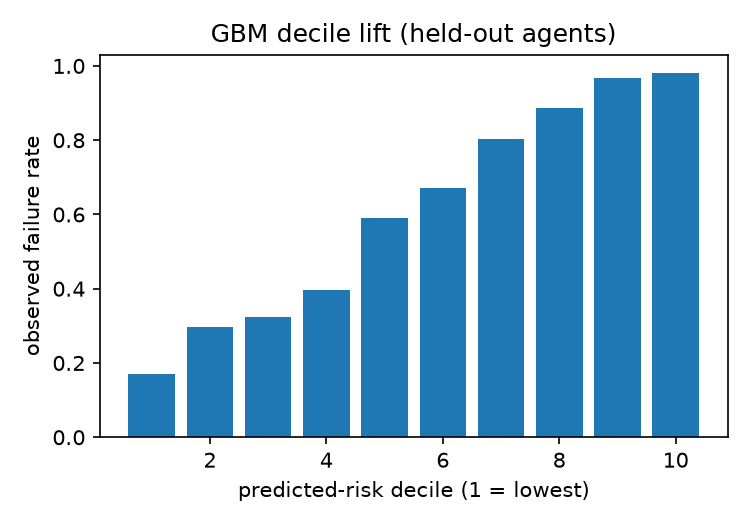

# Telemetry predicts agent task failure within one benchmark and does not transfer across benchmarks: evidence and requirements for agent liability rating

Blaise Wangmeni  
Entruva  
Correspondence: blaise.wangmeni@gmail.com, contact@entruva.ai

Version 1.1, 2026-11-13 (version 1: 2026-11-02). Version 1.1 corrects the text of version 1 after a pre-submission review; no analysis was rerun and no result file changed, and every correction is listed in paper/CHANGELOG.md. Results are frozen at the close of a preregistered study; every analysis choice made after the preregistration is dated in its deviations register. Every number below traces to a result file in the study repository (see Data and code availability).

## Abstract

Insurers are excluding AI-related losses from standard liability lines while specialist products insure AI performance, and neither side publishes a rating factor. This preregistered study tests whether runtime telemetry from AI agents (tool calls, errors, text and run lengths) predicts task failure better than a baseline that sees only model identity, task type and task length. On 44,643 runs from 41 agents across four benchmarks, a gradient boosting model on telemetry reached a held-out AUC of 0.843 (95% CI 0.777 to 0.888) against 0.654 for the baseline, and runs in the top predicted-risk quartile failed four times as often as runs in the bottom; the three prediction clauses frozen before data collection passed. The gain sits in one benchmark: cross-validated within benchmarks it is +0.281 in AgentDojo and -0.028 in SWE-bench, and a score trained on other benchmarks never beat the in-benchmark baseline. None of four tested telemetry edits moved a typical agent a risk decile, but one held-out agent in ten could cross a decile boundary at no cost, so the manipulation clause, whose floor was set after the prediction results, fails on its stricter reading. On-chain reputation registries are no substitute: nine in ten rated agents have a single feedback giver, and a median reputation costs about 0.27 USD to fabricate. Telemetry is a candidate frequency factor within one benchmark, not a portable one. Rating on it would first need loss-labelled outcomes, passes in three domains, more held-out agents and a manipulation floor that holds for every agent.

Keywords: AI agents, liability insurance, rating factors, telemetry, preregistration, ERC-8004, adversarial robustness

## 1. Introduction

The insurance market has taken two positions on AI agents at once. Several large carriers have filed exclusions removing AI-related damages from general liability, directors and officers, and errors and omissions forms, the broadest of them reaching "any actual or alleged use, deployment, or development of Artificial Intelligence" (Fehling et al., 2025; Hunton Andrews Kurth, 2025). In the same period Munich Re's aiSure, Armilla's Lloyd's-backed cover and Beazley's affirmative AI cyber wording insure AI failure as a named peril (Hunton Andrews Kurth, 2025; Insurance Journal, 2026; Munich Re, 2026). Both positions assume that AI failure risk is identifiable at the level of a policy. Neither side has published what identifies it. Motor insurance went through the same transition two decades ago when telematics made driving behaviour observable, and the question of whether the observed behaviour added anything to the classical rating variables was settled by out-of-sample prediction on claims data (Verbelen, Antonio and Claeskens, 2018). No equivalent test exists for AI agents.

This paper reports one. The preregistered hypothesis is that runtime behavioural telemetry from AI agents predicts task failure out of sample better than a naive baseline that knows only which model the agent runs, what kind of task it is doing, and how long the task is, and that it does so well enough to serve as a rating factor. The three prediction thresholds and the baseline definition were frozen before any data was fetched. The manipulation-cost floor was left open at the freeze and set after the prediction results were known, before any attack was run. Every later analysis choice was dated in a deviations register, public since 2026-11-02, before the run that used it (Nosek et al., 2018).

Expected insured loss factorises into how often an agent fails, how often a failure causes harm, and how large the harm is. This study tests telemetry against the first term only, because it is the only term with public ground truth at scale. In every data source the failure label is task non-completion: the AgentDojo utility flag, an unresolved SWE-bench instance, a tau-bench reward below one, a WebArena fail. It is not harm. Benchmark tasks are not production tasks, and no public dataset labels agent runs with insured losses. Telemetry is therefore tested here as a candidate frequency factor, the analogue of claims frequency in motor rating, and the paper says nothing about severity. These three limits are stated here rather than in the limitations section because they bound every claim that follows.

The claim of this paper is conditional. Telemetry predicts failure out of sample on the pooled held-out set, with a 0.19 AUC margin over the baseline and a four-to-one quartile separation, and the gain is concentrated in one benchmark, AgentDojo. None of the four telemetry edits tested lowers the score of the typical agent or of the worst-scoring agents. The signal does not port across benchmarks, reverses inside SWE-bench, and has no loss-labelled validation. The three preregistered prediction clauses passed on the pooled set; the manipulation clause passes or fails depending on a reading that was fixed after the prediction results (Section 4.3), and the within-benchmark table shows that the prediction pass is carried by one benchmark. The paper also shows that the on-chain reputation registries now being promoted as a trust layer for agents are not a substitute input, because their feedback is cheap to fabricate and almost always comes from a single wallet.

The paper makes four contributions. First, a preregistered, agent-grouped, out-of-sample test of telemetry as a rating factor with frozen thresholds and a dated deviations register. Second, a manipulation-cost analysis that reports both the median-agent rule fixed in the deviations register and the stricter any-agent reading, with the tail result that the worst-scoring agents cannot improve their score by any of the attacks tested. Third, a full-history audit of the ERC-8004 identity and reputation registries on three chains, cross-checked row for row against an independent public dataset. Fourth, a numeric statement of what an insurer would need before rating on telemetry, each requirement tied to the limitation in this study that motivates it. The author founded a company whose premise is the one tested here; the conflict is stated in the declarations and the Discussion is written so that the result argues against that premise wherever the data does.

## 2. Background

### 2.1 Behavioural data as a rating factor

Telematics in motor insurance is the closest precedent. Verbelen, Antonio and Claeskens (2018) showed on a Belgian portfolio that telematics variables improve the prediction of claim frequency and make some classical rating variables redundant; the test was out of sample on claims, and the result was expressed as relativities in a frequency model, which is the form an actuary can use. Cyber insurance offers the counter-example: Romanosky et al. (2019) analysed over a hundred filed cyber policies and found that carriers price cyber risk with little consistency and few measured inputs, which is roughly where AI agent risk stands now. The AI-specific products listed above are performance guarantees on agreed metrics such as an accuracy rate, which is a per-contract measurement rather than a rating factor across a book.

### 2.2 Agent benchmarks and their labels

Public agent benchmarks supply the only large ground-truth record of agent behaviour with outcomes. AgentDojo evaluates tool-using agents on 97 realistic tasks with 629 security test cases, and records both whether the agent completed the user's task and whether an injected instruction succeeded (Debenedetti et al., 2024). SWE-bench poses real GitHub issues and scores a run by whether the resulting patch resolves the issue (Jimenez et al., 2024); SWE-agent is the agent scaffold whose published runs are used here (Yang et al., 2024). tau-bench simulates a user interacting with a tool-using agent under policy constraints in airline and retail domains and scores by comparing the final database state to a goal (Yao et al., 2024). WebArena hosts functional websites and evaluates agents on 812 long-horizon tasks with programmatic checks (Zhou et al., 2023). Each benchmark defines failure as task non-completion, and each publishes execution traces from which behavioural features can be extracted. The AI Incident Database catalogues real-world harms (McGregor, 2021), but its entries carry no telemetry.

### 2.3 On-chain agent reputation

ERC-8004 proposes three registries on Ethereum-compatible chains, for identity, reputation and validation, so that agents can discover and choose each other without prior trust (De Rossi et al., 2025). The reputation registry records feedback from one address about an agent. Any such system faces the Sybil problem: without a trusted authority, one party can present many identities (Douceur, 2002). Xiong et al. (2026) crawled the three largest deployments through May 2026 and concluded that the reputation registry as deployed cannot function as a trust signal, with a large fraction of reviewers showing coordinated Sybil behaviour. Liu (2026) released a public dataset of the first 10,000 agents registered on Ethereum, which serves here as an independent cross-check of the study's own collection.

## 3. Methods

### 3.1 Preregistration and governance

Hypotheses, the thresholds of clauses 1 to 3, the baseline definition and the data sources were frozen at a tagged commit before any data was fetched; the clause 4 floor was left open at the freeze. The preregistration was held in the study's own git repository, which was private until 2026-11-02, and was not deposited with a third-party registry. The study then ran in five stages, each closed and reviewed before the next began: data readiness, prediction, manipulation cost and secondary hypotheses, external validation (reduced to collection cross-checks, Section 3.9), and the reputation registry audit. Every analysis choice the preregistration left open was recorded in a deviations register with its date, its reason and whether it was made before or after the result it affects was known. Fourteen entries exist. None changes a threshold of clauses 1 to 3; the entry of 2026-10-25 sets the clause 4 floor after the prediction results were known, and the entry of 2026-11-13 records the text corrections of this version. The register is reproduced in Section 4.7.

### 3.2 Hypotheses and thresholds

H1: runtime behavioural telemetry predicts task failure out of sample better than the naive baseline, well enough to serve as a rating factor. The baseline sees only model identity, task type and task length. H1 is supported only if all four clauses hold on the held-out agents:

1. The lower bound of the 95 percent bootstrap interval of the telemetry model's AUC exceeds the baseline's point AUC by at least 0.05.
2. The Brier skill score against the baseline is above zero with its 95 percent interval excluding zero.
3. The failure rate in the top predicted-risk quartile divided by the bottom quartile is at least 2.0, and the decile lift table is monotone (Spearman correlation above 0.8 between decile rank and observed failure rate).
4. The cheapest manipulation that lowers an agent's predicted risk by one decile without changing its true failure rate costs at least three times the annual premium saving it buys. The multiple of three was left open at the freeze and set on 2026-10-25, after the prediction results and before any attack was run.

Secondary hypotheses: S1, whether reputation components add value beyond telemetry; S2, whether a score learned on one domain predicts failure in another (supported when the paired AUC gain over the in-domain baseline has a lower bound of at least 0.05); S3, the cost of manipulation, reported in dollars, for which the preregistration named whitewashing, Sybil feedback, collusion and strategic oscillation (Section 3.7 states what was tested); S4, a premium-coupled simulation reporting whether aggregate trust quality converges or collapses as the attacker fraction rises.

### 3.3 Data and the failure label

Five of the six sources in the collection plan were obtained in the first week; the sixth, ERC-8004 registry events, arrived later and carries no task outcomes. Two further items named in the preregistration were not collected and are recorded as such in the manifest: the OECD AI Incidents Monitor, which publishes no export or API, and the ERC-8004 validation registry, which has no published contract address. Benchmark traces with ground-truth labels form the modelling set (Table 1). Every source is recorded in a manifest with URL or contract address, fetch date, row count, checksum and licence.

Table 1. Modelling set.

| Source | Rows | Agents | Failure rate |
|---|---|---|---|
| AgentDojo | 36,678 | 29 | 0.456 |
| WebArena | 4,818 | 6 | 0.928 |
| tau-bench | 1,980 | 2 | 0.403 |
| SWE-bench (SWE-agent runs) | 1,167 | 4 | 0.817 |
| Total | 44,643 | 41 | 0.514 |

An agent is a model and scaffold pair within a source. The preregistration speaks of task domains. In this study a domain is operationalised as a benchmark source, so a difference between domains is also a difference in scaffold, in how the failure label is defined and in which telemetry features exist; the text says benchmark where the claim is about a benchmark. The 274 AI Incident Database rows that matched an agentic keyword rule are all failures and carry no telemetry; they are excluded from every model and used only as context. The label in every source is task non-completion as defined by the benchmark's own scorer; for AgentDojo this is the utility flag, not the security outcome.

### 3.4 Features

The preregistration named four telemetry families: latency distributions, error rates, tool-call sequences and output consistency. No source publishes per-step latency or retry records, so those families are absent in 100 percent of rows and were recorded as such before any model was fit. The ten telemetry features used are the number of tool calls, number of distinct tools, repeat-call ratio, number of errors, error rate, longest error run, mean text length per tool call, run duration where published, API call count and tokens sent. The text length is that of the tool output in AgentDojo, tau-bench and SWE-bench and of the agent's parsed action in WebArena, so this feature does not measure the same thing in every source. Run duration is published only by AgentDojo; API call count, tokens sent and exit status only by the SWE-agent runs. The baseline inputs are model identity, task type and task length in steps. Task length is the number of steps the run took, read from the same trace as the telemetry, and is not a property of the task known in advance. Exit status is a categorical input to the telemetry model. A check that no feature equals the outcome runs before every fit.

### 3.5 Split and evaluation

No benchmark row has a timestamp, so the held-out split is by agent rather than by time: 20 percent of agents per source, drawn with a fixed seed and frozen in a file before any model was fit. The held-out set is 10 agents with 9,298 rows (failure rate 0.609); the training set is 31 agents with 35,345 rows. All intervals are 95 percent cluster bootstraps over agents with 2,000 resamples, which is wider than a row bootstrap and is the honest choice when rows within an agent are correlated (Efron, 1979). Quartile ties in predicted risk are broken by a seeded random key and the ratio is averaged over 25 draws, with counts reported alongside. A power simulation run at the data-readiness stage reported power of 1.0 at every AUC gain it tried, the smallest being 0.02. The realised 95 percent interval on the paired gain reaches about 0.1 either side of the estimate (Table 2), so the simulation understated the variance between agents and should not be read as a minimum detectable effect; agent count, not row count, is the binding constraint. As a robustness check, grouped five-fold cross-validation over all 41 agents was run after the primary result.

### 3.6 Models

The baseline is a logistic regression on one-hot model identity and task type plus standardised task length. The telemetry model is a histogram gradient boosting classifier with library defaults and a fixed seed (Friedman, 2001), with median imputation for missing numerics. Two sensitivity models are reported and do not decide the hypothesis: the same classifier on telemetry alone, without model identity or task type, and a logistic regression on the full input set. AUC is interpreted as the probability that a random failure is ranked above a random success (Hanley and McNeil, 1982); the Brier score is the mean squared error of the predicted probability (Brier, 1950). For the actuarial framing, a Poisson regression on standardised telemetry features reports relativities per one standard deviation. All models use scikit-learn 1.9.1 (Pedregosa et al., 2011).

### 3.7 Manipulation cost

The preregistration named whitewashing, Sybil feedback, collusion and strategic oscillation as the manipulations to cost. Those are attacks on a reputation system. Sybil feedback, collusion and re-registration, which is what whitewashing costs on-chain, are costed for the registries in Section 4.5; strategic oscillation was not costed, and neither whitewashing nor strategic oscillation was tested against the telemetry score. For the telemetry score, four feature-level attacks were specified in the deviations register on 2026-10-27, after the prediction results and before any was run. Each states the trace change an operator would make and moves every feature the extractor would move: error suppression (errors become silent identical retries), retry diversification, call shaping (padding calls added or redundant calls dropped, at strengths from -32 to +32 calls) and message shaping (text length scaled by 0.25 to 4). Per-run cost is the added text at the model vendor's public list price; error suppression and retry diversification add no text and cost nothing. Each attack is applied to the held-out agents' real rows and scored by the frozen prediction model. The unit of movement is a decile of predicted risk, with decile edges fixed from the honest held-out scores. The breakeven exposure for an attack is X* = (E + cR) / (3 dp), where E is a one-time engineering cost (0 or 10,000 USD), c the per-run cost, R the runs per year (1,000 or 100,000) and dp the drop in decile-mean predicted probability. Clause 4 passes in a scenario cell when the cheapest priced decile-moving attack has X* above the cell's exposure (1,000 to 1,000,000 USD), and overall only when every one of the 16 cells passes. Two readings are reported: the median-agent reading, in which an attack moves a decile when it does so for at least half of the held-out agents that can move, and the any-agent reading, in which one agent suffices. The median-agent reading is not in the preregistration, whose clause speaks of lowering "an agent's" predicted risk; it was fixed in the deviations register on 2026-10-27, after the held-out scores existed and before any attack was run. Six of the ten held-out agents run on one of five models that are unpriced in the study's price table: four models that their vendor no longer lists on its current pricing page, three of them retired, and one open-weights model with no vendor list price. By the rule fixed in the same register entry an unpriced attack is never the cheapest.

### 3.8 Portability

For each source, the telemetry model was trained on the other sources' training agents (telemetry, step count and exit status, without model identity, which does not transfer) and scored on that source's held-out agents against the in-domain baseline. Sources with a single held-out agent are reported but cannot be evaluated by the paired rule.

### 3.9 Reputation registries

ERC-8004 identity and reputation events were collected in full on Ethereum mainnet (to 2026-10-25, through a keyless public endpoint) and on Base and BNB Smart Chain (to 2026-11-02, through a paid endpoint after a free-tier limit of ten blocks per request made full history impractical). Contract addresses were taken from the EIP and the reference repository, never guessed. The collector requests logs in chunks of at most 10,000 blocks after a silent truncation above that size was found on the paid endpoint and corrected. Every file passes an integrity check: registration ids contiguous from zero and equal to the mint set, feedback index sequences contiguous from one for every agent, no duplicate log. Gas cost per action was measured from 400 sampled Ethereum receipts at the block-day ETH price. The Ethereum collection was cross-checked row for row against the public dataset of Liu (2026) with zero tolerance for a mismatch, and the latest registration id on each chain was compared with a public block explorer.

### 3.10 Simulation

The S4 flywheel is synthetic and feeds no headline result. Five hundred agents draw their true failure rates from the held-out agents; each of twelve rounds, every agent's observed telemetry is a resample of its source agent's real rows, attackers apply the cheapest attack when the expected premium saving exceeds its cost, and the insurer refits the prediction model class on the previous round's observed rows. The attacker fraction sweeps from 0 to 1 in steps of 0.05. Convergence and collapse were defined before the simulation was written: converged when post-burn-in AUC stays inside the prediction model's held-out AUC interval, collapsed when it stays below the baseline.

## 4. Results

### 4.1 Pooled prediction

All three prediction clauses held on the held-out agents (Table 2). The telemetry model's AUC lower bound exceeded the baseline point estimate by 0.124 against a required 0.05; the Brier skill interval excluded zero; the top quartile failed 4.14 times as often as the bottom (2,249.4 of 2,324 runs against 544 of 2,325, averaged over 25 tie-break draws) and the decile table was perfectly monotone (Figure 2).

Table 2. Held-out performance, 10 agents, 9,298 rows. Intervals are 95 percent cluster bootstraps over agents.

| Score | AUC [CI] | Paired gain over baseline [CI] | Brier skill [CI] | Quartile ratio |
|---|---|---|---|---|
| Naive baseline (model identity, task type, task length) | 0.654 [0.528, 0.803] | | | |
| Gradient boosting, telemetry plus baseline inputs (primary) | 0.843 [0.777, 0.888] | 0.189 [0.067, 0.288] | 0.220 [0.049, 0.315] | 4.14 |
| Gradient boosting, telemetry only | 0.839 [0.768, 0.885] | 0.186 [0.058, 0.290] | 0.233 [0.047, 0.326] | 4.04 |
| Logistic regression, same inputs as primary | 0.767 [0.638, 0.849] | 0.113 [-0.004, 0.230] | 0.104 [-0.089, 0.213] | 2.84 |

The telemetry-only model matches the primary model, so the gain is not model identity leaking through telemetry. The linear model would not have passed clauses 1 or 2, so the signal is non-linear or carried by interactions. The reliability curve (Figure 1) under-predicts in each of the eight bins below a predicted probability of 0.8, by 0.05 to 0.18, and most in the 0.3 to 0.5 band (predicted 0.35 and 0.45 against observed 0.49 and 0.63); only the two highest bins are within 0.03 of the diagonal. A premium schedule built on these probabilities would need recalibration on the target book. Grouped five-fold cross-validation over all 41 agents gave a pooled out-of-fold baseline AUC of 0.590, telemetry model 0.792 [0.755, 0.826], paired gain 0.202 [0.140, 0.259], Brier skill 0.218 [0.133, 0.281] and quartile ratio 4.21, so the primary result is not an artefact of one split.

The Poisson frequency model, fit on all benchmark rows without a source control, gives relativities per standard deviation whose intervals exclude one for tool calls 1.48 [1.32, 1.70], repeat-call ratio 1.13 [1.05, 1.23], error rate 1.08 [1.04, 1.12], API calls 0.90 [0.85, 0.99], mean text length 0.86 [0.82, 0.91] and task length 0.75 [0.65, 0.85]. More tool calls, more repeated identical calls and a higher error rate load toward failure. This is descriptive: task length is measured in different units per source and the model has no source control, so it is not a rating plan.

### 4.2 Within benchmarks

Evaluating inside each source removes between-source base-rate differences and changes the picture (Table 3). The intervals in Table 3 come from the grouped five-fold cross-validation over all 41 agents, because the frozen held-out set has a single agent in two of the four sources. The last two columns give the point AUCs on each source's held-out agents from the primary run.

Table 3. Within-source evaluation. Rows, agents, baseline AUC, telemetry AUC, paired gain and Brier skill: grouped five-fold cross-validation over all agents of the source, out-of-fold predictions, 95 percent cluster bootstrap intervals. Last two columns: point AUCs on the source's held-out agents in the frozen split (AgentDojo 6,744 rows, SWE-bench 289, tau-bench 660, WebArena 1,605).

| Source | Rows | Agents | Baseline AUC | Telemetry AUC [CI] | Paired gain [CI] | Brier skill [CI] | Held-out baseline AUC | Held-out telemetry AUC |
|---|---|---|---|---|---|---|---|---|
| AgentDojo | 36,678 | 29 | 0.478 | 0.759 [0.723, 0.793] | +0.281 [+0.226, +0.333] | +0.237 [+0.152, +0.305] | 0.530 | 0.812 |
| SWE-bench | 1,167 | 4 | 0.592 | 0.564 [0.518, 0.688] | -0.028 [-0.121, +0.010] | -0.458 [-0.946, -0.040] | 0.700 | 0.630 |
| tau-bench | 1,980 | 2 | 0.648 | 0.667 [0.667, 0.707] | +0.020 [+0.020, +0.064] | +0.187 [+0.186, +0.190] | 0.639 | 0.714 |
| WebArena | 4,818 | 6 | 0.618 | 0.642 [0.579, 0.699] | +0.024 [-0.005, +0.053] | +0.077 [-0.001, +0.192] | 0.670 | 0.727 |

The pooled pass is carried by AgentDojo, which is 82 percent of rows and 72 percent of the held-out set. Inside SWE-bench, telemetry is worse than the baseline on both ranking and calibration, with a Brier skill interval that excludes zero on the wrong side. Inside tau-bench and WebArena the cross-validated gain is small; the WebArena interval includes zero, and the tau-bench intervals are degenerate because the source has two agents. The held-out point estimates agree in direction in every source: a large gain in AgentDojo, a loss in SWE-bench, and smaller gains in tau-bench and WebArena that rest on one and two held-out agents and carry no interval. A within-source pass rule was not added after these numbers were seen, because adding a rule after the data is what the preregistration exists to prevent; the pooled rule stands as preregistered and this table stands as the main caveat on it.

### 4.3 Manipulation cost

Under the median-agent reading no attack moves a decile, and clause 4 passes in all 16 scenario cells. Under the any-agent reading, error suppression moves one held-out agent (Llama 3.3 70B on AgentDojo) from decile 6, with a decile-mean predicted probability of 0.560, to decile 5 at 0.409, a drop of 0.151, at zero per-run cost. With no engineering cost the breakeven exposure is 0 USD and every such cell fails; with a 10,000 USD engineering cost it is 22,087 USD, so the cells at 100,000 and 1,000,000 USD exposure fail as well. Twelve of 16 cells fail under this reading. The verdict on clause 4 therefore depends on the reading. The median-agent reading was fixed after the held-out scores existed, and the preregistered wording ("lowers an agent's predicted risk by one decile") is closer to the any-agent reading. On the any-agent reading clauses 1 to 3 hold and clause 4 fails, which the preregistration calls "predictive but gameable", not supported. On the median-agent reading all four clauses hold. H1 is therefore reported as predictive on the pooled held-out set and gameable at the margin: one held-out agent in ten can cross a decile boundary at no cost.

The tail matters more to an insurer than the median. Across all twenty attack settings (Figure 3) there are three downward decile moves in the whole held-out set, and all three are mid-distribution agents moving from decile 6 to 5 (Table 4). The two worst-scoring held-out agents, both WebArena agents at a predicted probability of 0.93, never move down a decile under any of the attacks tested; the free attacks push their scores up, not down, and error suppression moves one of them up a decile. The gameable margin is a middle-of-the-distribution effect: an agent whose honest score sits near a decile boundary can nudge itself across for free, while the agents an insurer most needs to identify stay identified. The held-out tail is two or three agents, and both of the worst are WebArena agents, where the within-domain signal is weak, so this is evidence about where the attacks act rather than proof that the tail is safe.

Table 4. Downward decile moves across all attack settings, held-out agents.

| Attack | Strength | Per-run cost (USD) | Agent | Decile before and after |
|---|---|---|---|---|
| Error suppression | none | 0 | Llama 3.3 70B, AgentDojo | 6 to 5 |
| Retry diversification | none | 0 | Llama 3.3 70B, AgentDojo | 6 to 5 |
| Message shaping | 4x | 0.04 | GPT-4o with injection detector, AgentDojo | 6 to 5 |

### 4.4 Portability

S2 is not supported anywhere (Table 5). On AgentDojo the cross-domain score beats the in-domain baseline, but by less than the 0.05 lower bound required. On WebArena it is worse than the baseline. SWE-bench and tau-bench have one held-out agent each and cannot be evaluated by the paired rule. A telemetry factor fit on one domain should not be applied to another without re-fitting.

Table 5. Cross-domain score against the in-domain baseline.

| Target source | Held-out agents | Cross-domain AUC | In-domain baseline AUC | Paired gain [CI] |
|---|---|---|---|---|
| AgentDojo | 6 | 0.669 | 0.529 | +0.139 [+0.035, +0.192] |
| WebArena | 2 | 0.507 | 0.673 | -0.166 [-0.199, -0.109] |
| SWE-bench | 1 | 0.595 | 0.700 | not evaluable |
| tau-bench | 1 | 0.646 | 0.648 | not evaluable |

S1, whether reputation adds value beyond telemetry, could not be evaluated: the benchmark agents have no on-chain identity and the on-chain agents have no task outcomes, so no join exists.

### 4.5 The reputation layer across three chains

The complete event history of the ERC-8004 identity and reputation registries on Ethereum, Base and BNB Smart Chain passes the integrity check on every chain, and the count of registered agents matches a public block explorer on each (Table 6, Figure 4).

Table 6. ERC-8004 registries, full history (Ethereum to 2026-10-25, Base and BNB to 2026-11-02).

| | Ethereum | Base | BNB Smart Chain |
|---|---|---|---|
| Agents registered | 55,407 | 1,149,957 | 401,341 |
| Feedback events | 34,493 | 673,980 | 30,144 |
| Agents receiving feedback | 2,651 | 152,281 | 4,482 |
| Of those, with a single feedback giver | 2,444 (0.92) | 138,387 (0.91) | 3,988 (0.89) |
| Distinct feedback givers | 721 | 136,371 | 143 |
| Feedback per rated agent, median / p75 / max | 1 / 9 / 636 | 1 / 1 / 390,890 | 1 / 1 / 234 |
| Share of feedback from registrant wallets | 0.015 | 0.224 | 0.015 |

Fewer than one registered agent in twenty has received any feedback on Ethereum and BNB Smart Chain, about one in eight on Base, and on every chain the median rated agent has one entry from one wallet. Base differs in scale, not in shape: a single agent holds 390,890 of its 673,980 feedback entries. On Ethereum, from 400 sampled receipts at the block-day price, one registration costs 0.17 USD in gas, one feedback event 0.10 USD, a Sybil campaign that brings a fresh identity to the median feedback count 0.27 USD, and a five-agent collusion ring 1.93 USD. The independent cross-check against Liu (2026) found every one of that dataset's 10,000 agents, 1,961 transfers and 980 feedback records in the study's collection, with feedback counts equal for 9,991 agents and no higher than the study's count for the rest, which is consistent with the later fetch date; the observation block implied by every owner matching is 24,744,960. The study's models use none of this data; the audit bounds what a future reputation-weighted score would cost to game and shows that the registries as deployed carry almost no independent information about any agent.

### 4.6 Simulation

The synthetic flywheel is reported because S4 was preregistered; it is not informative. No cell collapsed: post-burn-in AUC was 0.756 to 0.757 at every attacker fraction from 0 to 1 against a baseline of 0.654 (result file 2026-10-28_S4_flywheel_synthetic.json and its figure, not reproduced here). Neither preregistered outcome fired by its own rule. "Converged" required AUC inside the prediction model's held-out interval [0.777, 0.888], which sits above the ceiling of a population whose outcomes are Bernoulli draws from fixed rates, and "no collapse" is close to guaranteed by construction because model identity, which no attack touches, nearly identifies the source agents. The simulation shows only that refitting on telemetry gamed by these four attacks does not degrade ranking in this construction; it says nothing about attacks it did not model.

### 4.7 Deviations register

Table 7 reproduces the register. Four kinds of entry follow a result. The dollar floor was set after the prediction result and before any attack ran. The attack set, the decile unit and the median-agent reading were fixed on 2026-10-27, after the held-out scores they are computed from existed and before any attack ran. Seven corrections to the attack code were made after a first adversarial run and before the rerun, and changed no verdict. The entries of 2026-11-02 and 2026-11-13 follow every result and concern collection, publication timing and the text.

Table 7. Deviations from the preregistration.

| Date | What | Timing |
|---|---|---|
| 2026-10-19 | Clause 4 dollar floor deferred at the freeze | before any data |
| 2026-10-23 | Model input set fixed, incident rows excluded, latency recorded absent, agent-grouped split, monotonicity as Spearman above 0.8 | before any model fit |
| 2026-10-24 | S1 deferred for lack of reputation data; S2 and the frequency model operationalised | before S2 or GLM results |
| 2026-10-25 | Dollar floor set at three times annual saving | after prediction results, before any attack |
| 2026-10-27 | S1 not evaluable, no join exists | before the manipulation analysis |
| 2026-10-27 | Attack set, decile unit, median-agent reading, breakeven formula, scenario grid, pricing | after prediction results, before any attack run |
| 2026-10-27 | S4 constants and outcome rules | before the simulation was written |
| 2026-10-28 | Seven corrections to the manipulation analysis from a code review, then a rerun | after the first run, before the rerun; no verdict changed |
| 2026-10-28 | External validation reduced to collection cross-checks | after a data request went unanswered |
| 2026-10-28 | Cross-check rules, zero tolerance | before the run |
| 2026-10-29 | Base and BNB reduced to a two-day window at zero spend | before the run; superseded |
| 2026-11-02 | Base and BNB full history through a paid endpoint; chunk cap after a silent truncation was found | after the windowed run; statistics unchanged |
| 2026-11-02 | Publication date set; research repository opened | after all results were known; timing only |
| 2026-11-13 | Version 1.1 text corrections; frozen preregistration text restored; provenance path fixed | after all results were known; no result changed |

## 5. Discussion

### 5.1 What the result shows

The three preregistered prediction clauses passed, and the honest statement of what passed is narrower than the rule. On AgentDojo, where 29 agents on a shared task suite give the model something to learn, telemetry adds a large and well-bounded margin over model identity and task type, and the ranking it produces separates failures from successes by four to one between the extreme quartiles. That is the kind of signal an actuary would want to see from a candidate frequency factor, and the frequency model's relativities are interpretable: agents that call tools more, repeat the same call more and hit more errors fail more. Outside AgentDojo the evidence is thin to negative. Inside SWE-bench the baseline is better, which is consistent with software engineering failure being a property of the task's difficulty rather than of how the agent behaves on the way, and with four agents being too few to learn anything else. A rating factor that behaves this way is at best a within-benchmark factor, and it has been shown in one benchmark of four. The practical consequence is that any telemetry factor must be fit and validated per task domain, and that an insurer whose book spans domains needs a domain variable before a telemetry variable.

The telemetry-only sensitivity model matches the primary model (Table 2), so the telemetry features carry the signal without the model identity and task type columns. This study does not establish why. In particular it does not separate how much of the signal describes the agent and how much describes the task the agent was given: the baseline has no task identifier, and within a benchmark the same tasks are run by the training agents and the held-out agents.

### 5.2 Why not on-chain reputation

An insurer looking for an input that is already public and already standardised will find ERC-8004. Section 4.5 is the answer to that question, and it is a negative one on present evidence. On three chains, nine in ten rated agents have a single feedback giver; fewer than one registered agent in twenty has any feedback on Ethereum and BNB Smart Chain and about one in eight on Base; and the cost of fabricating a median reputation on Ethereum is about a quarter of a dollar. This agrees with Xiong et al. (2026), who reached the same conclusion from a different crawl with a Sybil-detection method. It does not mean that reputation can never be an input. It means that feedback count is not one, that any reputation component would have to weight feedback by something an attacker cannot buy for 0.10 USD, and that until the registries carry verifiable interaction records, telemetry is the only one of the two candidate inputs that has survived an out-of-sample test.

### 5.3 What an insurer would need

The requirements below are the author's proposals. Each is tied to the limitation in this study that motivates it and is stated as a number so that it can be met or shown not to be met.

1. Loss-labelled outcomes. The label must be an insured-loss event or a harm proxy agreed with the carrier, not task non-completion. No public dataset provides this; a carrier running an AI performance cover already has claims and could supply it.
2. Independent passes in at least three task domains. Each domain must satisfy clauses 1 to 3 on its own held-out agents: an AUC lower bound at least 0.05 above the domain baseline, a Brier skill interval excluding zero, and a quartile ratio of at least 2.0. This study meets that bar in one domain of four.
3. Enough held-out agents that no single agent spans a decile. With ten held-out agents the decile unit is coarse and the median and any-agent readings of the manipulation rule disagree. The proposal is at least 30 held-out agents per domain, so that a decile contains three agents and a single mover cannot flip the verdict.
4. A manipulation floor that holds under the any-agent reading. The cheapest decile-moving attack must have a breakeven exposure above the largest exposure in the book, at an engineering cost of zero, in every scenario cell. This study fails that bar in 12 of 16 cells.
5. Calibration within 0.05. The reliability curve under-predicted in every bin below 0.8, by up to 0.18 in the 0.3 to 0.5 band. A rating plan needs recalibration on the target book with absolute error no greater than 0.05 in every decile, verified out of sample.
6. The latency family. No source published per-step latency or retries, so a preregistered feature family went untested. Production telemetry has it; a validation on production data should include it.
7. Portability tested, not assumed. Before a factor fit in one domain is applied to another, the cross-domain paired gain over the in-domain baseline must have a lower bound of at least 0.05, which it did not here in any domain.

### 5.4 Limitations

The pass is domain-concentrated and the within-domain evidence is thin outside AgentDojo. There are 41 agents in total and between two and six in three of the four sources, so some intervals are wide or degenerate. The label is benchmark non-completion, not harm, and benchmark agents are not production agents. Two preregistered telemetry families were absent in every source. Every telemetry feature, and the task length in the baseline, is read from the same run whose outcome is scored, so the test is of discrimination within a run and not of prediction from an earlier period, which is what a rating factor needs. The attacks are feature-level: an operator rewriting whole traces could find interactions the four attacks miss, the engineering cost is a parameter rather than a measurement, and six of the ten held-out agents are unpriced. Whitewashing and strategic oscillation, which the preregistration named, were not tested against the telemetry score. The held-out set of ten agents makes the decile coarse, and the two readings of clause 4 disagree. The simulation is synthetic, its convergence band sits above its own ceiling, and its no-collapse result is close to guaranteed by construction. There is no external validation of the prediction model; the external data that arrived carries no outcomes. The dollar floor was set after the prediction result was known, the median-agent reading of clause 4 was fixed after the held-out scores existed, and the attack code was corrected after a first run; all three are dated in the register, and a reader is entitled to weigh them. The preregistration was self-held in a repository that was private until publication, with no third-party timestamp.

### 5.5 Conflict of interest and how the paper handles it

The author founded Entruva, whose premise is that telemetry can rate agent liability. A study designed by the person with that interest is at risk of finding it, and the design choices that limit that risk are the ones reported here: thresholds frozen before data, an agent-grouped held-out set frozen before fitting, every later choice dated, a stricter any-agent reading of the manipulation rule reported next to the median-agent one, a within-domain table that undercuts the pooled pass, and a requirements list that the study itself mostly fails. The result argues against the premise wherever the data does: across domains, inside SWE-bench, and at the decile margin.

## 6. Conclusion

Runtime telemetry predicts AI agent task failure out of sample on the pooled benchmark set and inside one benchmark of four, by a margin an actuary would recognise, and none of the four telemetry edits tested lowers the score of the typical or the worst-scoring agents. It does not port across benchmarks, it is worse than the baseline inside one of the four benchmarks tested, and it has not been validated against an insured loss. On-chain reputation, the alternative input, is not yet an input at all. An insurer considering telemetry as a rating factor should treat it as a per-domain frequency factor awaiting loss-labelled validation, and the seven requirements in Section 5.3 are the test it has to pass.

## Declarations

Data and code availability. The study repository contains the preregistration, the deviations register, the data manifest with checksums, the frozen split, every result file with its commit hash and seeds, the collection and analysis code, and the stage reports. The commit hashes recorded in result files refer to the private monorepo the study was split from and do not resolve in the public repository, and every result file records git_dirty as true, a flag that was set whenever any file in the study tree was uncommitted or untracked when the result was written. The repository is public with its full history at https://github.com/blaise442/entruva-research from 2026-11-02. Benchmark traces were fetched from the public releases listed in Section 2.2 under their stated licences. ERC-8004 events were read from public chains. The Ethereum cross-check dataset is Liu (2026), CC0 1.0. Synthetic simulation outputs carry "synthetic" in the filename and feed no headline result.

Ethics. The study uses no human-subject data. Benchmark traces are machine-generated and public. On-chain data is public by design; wallet addresses are not reported.

Author contributions (CRediT). Blaise Wangmeni: conceptualisation, methodology, software, validation, formal analysis, investigation, data curation, writing, visualisation, project administration.

Conflict of interest. The author is the founder of Entruva, a company whose business depends on telemetry-based rating of AI agents. See Section 5.5.

Funding. No external funding. Paid blockchain data access for Base and BNB Smart Chain was bought by the author on 2026-11-01.

AI use. Analysis code, drafting and verification were carried out by an AI coding agent under the author's direction. Where the deviations register gives "executing agent" as the decider, the AI agent fixed that analysis choice and the author reviewed it at the close of that stage. The pre-submission review that led to version 1.1 was also carried out with an AI assistant. Every number in this paper was computed by the study's code and traces to a result file, and every reference was checked against its publisher page or DOI before inclusion.

## References

Brier, G. W. (1950). Verification of forecasts expressed in terms of probability. Monthly Weather Review, 78(1), 1-3. https://doi.org/10.1175/1520-0493(1950)078<0001:VOFEIT>2.0.CO;2

De Rossi, M., Crapis, D., Ellis, J., & Reppel, E. (2025). ERC-8004: Trustless Agents (Ethereum Improvement Proposal, Draft, created 2025-08-13). https://eips.ethereum.org/EIPS/eip-8004

Debenedetti, E., Zhang, J., Balunović, M., Beurer-Kellner, L., Fischer, M., & Tramèr, F. (2024). AgentDojo: A dynamic environment to evaluate prompt injection attacks and defenses for LLM agents. Advances in Neural Information Processing Systems 37 (NeurIPS 2024), Datasets and Benchmarks Track. arXiv:2406.13352. https://proceedings.neurips.cc/paper_files/paper/2024/hash/97091a5177d8dc64b1da8bf3e1f6fb54-Abstract.html

Douceur, J. R. (2002). The Sybil attack. In P. Druschel, F. Kaashoek, & A. Rowstron (Eds.), Peer-to-Peer Systems, IPTPS 2002, Lecture Notes in Computer Science 2429 (pp. 251-260). Springer. https://doi.org/10.1007/3-540-45748-8_24

Efron, B. (1979). Bootstrap methods: Another look at the jackknife. Annals of Statistics, 7(1), 1-26. https://doi.org/10.1214/aos/1176344552

Fehling, G. B., Levine, M. S., Moore, M., & Pappas, A. D. (2025, May 28). The continued proliferation of AI exclusions. Hunton Andrews Kurth Insurance Recovery Blog, via The National Law Review. https://natlawreview.com/article/continued-proliferation-ai-exclusions

Friedman, J. H. (2001). Greedy function approximation: A gradient boosting machine. Annals of Statistics, 29(5), 1189-1232. https://doi.org/10.1214/aos/1013203451

Hanley, J. A., & McNeil, B. J. (1982). The meaning and use of the area under a receiver operating characteristic (ROC) curve. Radiology, 143(1), 29-36. https://doi.org/10.1148/radiology.143.1.7063747

Hunton Andrews Kurth. (2025, July 2). How insurance policies are adapting to AI risk. Law360, republished by Hunton Andrews Kurth LLP. https://www.hunton.com/insights/publications/how-insurance-policies-are-adapting-to-ai-risk

Insurance Journal. (2026, September 17). Markets/Coverages: Beazley confirms affirmative AI cyber; CFC strengthens FI suite with upgrades, affirmative AI cover. https://insurancejournal.com/news/national/2026/09/17/885463.htm

Jimenez, C. E., Yang, J., Wettig, A., Yao, S., Pei, K., Press, O., & Narasimhan, K. (2024). SWE-bench: Can language models resolve real-world GitHub issues? International Conference on Learning Representations (ICLR 2024). arXiv:2310.06770. https://arxiv.org/abs/2310.06770

Liu, Y. (2026). A dataset of early blockchain-registered AI agents on Ethereum. arXiv:2604.22652. https://arxiv.org/abs/2604.22652. Data: Replication Data for "A dataset of early blockchain-registered AI agents on Ethereum", Harvard Dataverse, V3, CC0 1.0. https://doi.org/10.7910/DVN/HJZW8Q

McGregor, S. (2021). Preventing repeated real world AI failures by cataloging incidents: The AI Incident Database. Proceedings of the AAAI Conference on Artificial Intelligence, 35(17), 15458-15463. https://doi.org/10.1609/aaai.v35i17.17817

Munich Re. (2026). Insure AI: aiSure for self-built AI. https://munichre.com/en/solutions/for-industry-clients/insure-ai/ai-self.html

Nosek, B. A., Ebersole, C. R., DeHaven, A. C., & Mellor, D. T. (2018). The preregistration revolution. Proceedings of the National Academy of Sciences, 115(11), 2600-2606. https://doi.org/10.1073/pnas.1708274114

Pedregosa, F., Varoquaux, G., Gramfort, A., Michel, V., Thirion, B., Grisel, O., Blondel, M., Prettenhofer, P., Weiss, R., Dubourg, V., Vanderplas, J., Passos, A., Cournapeau, D., Brucher, M., Perrot, M., & Duchesnay, É. (2011). Scikit-learn: Machine learning in Python. Journal of Machine Learning Research, 12, 2825-2830. https://jmlr.org/papers/v12/pedregosa11a.html

Romanosky, S., Ablon, L., Kuehn, A., & Jones, T. (2019). Content analysis of cyber insurance policies: How do carriers price cyber risk? Journal of Cybersecurity, 5(1), tyz002. https://doi.org/10.1093/cybsec/tyz002

Verbelen, R., Antonio, K., & Claeskens, G. (2018). Unravelling the predictive power of telematics data in car insurance pricing. Journal of the Royal Statistical Society: Series C (Applied Statistics), 67(5), 1275-1304. https://doi.org/10.1111/rssc.12283

Xiong, X., Li, Z., Wei, W., Wang, Q., Knottenbelt, W., & Wang, Z. (2026). Can trustless agents be trusted? An empirical study of the ERC-8004 decentralized AI agent ecosystem. arXiv:2606.26028. https://arxiv.org/abs/2606.26028

Yang, J., Jimenez, C. E., Wettig, A., Lieret, K., Yao, S., Narasimhan, K., & Press, O. (2024). SWE-agent: Agent-computer interfaces enable automated software engineering. arXiv:2405.15793. https://arxiv.org/abs/2405.15793

Yao, S., Shinn, N., Razavi, P., & Narasimhan, K. (2024). tau-bench: A benchmark for tool-agent-user interaction in real-world domains. arXiv:2406.12045. https://arxiv.org/abs/2406.12045

Zhou, S., Xu, F. F., Zhu, H., Zhou, X., Lo, R., Sridhar, A., Cheng, X., Ou, T., Bisk, Y., Fried, D., Alon, U., & Neubig, G. (2023). WebArena: A realistic web environment for building autonomous agents. arXiv:2307.13854. https://arxiv.org/abs/2307.13854
